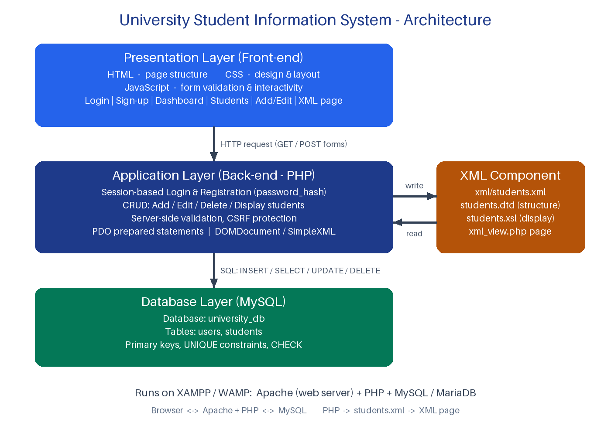

# University Student Information and Academic Management System

A web application for managing student academic records, built for the **BCA Course Project 2026**
(*Develop interactive web applications by integrating front-end and back-end technologies*).

| Layer | Technology | Used for |
|---|---|---|
| Presentation | **HTML, CSS** | Page structure, responsive design |
| Presentation | **JavaScript** | Client-side validation and interactivity |
| Application | **PHP** (PDO) | Login/registration, CRUD, server-side validation |
| Database | **MySQL** | `users` and `students` tables |
| XML | **XML + DTD + XSLT** | Storing and displaying student records |
| Server | **XAMPP / WAMP** | Local Apache + PHP + MySQL |



---

## Features (mapped to the project modules)

**Module 1: User Login and Registration**
- The login page (`index.php`) is the **splash page**. It has username and password fields.
- New users sign up at `register.php`. Passwords are stored with `password_hash()` (bcrypt).
- Logins are checked with `password_verify()`. Sessions protect every inner page.

**Module 2: Student Management (CRUD)**
- **Add:** `add_student.php`
- **Edit:** `edit_student.php?id=…`
- **Delete:** `delete_student.php` (POST only, with a JavaScript confirm box and a CSRF token)
- **Display:** `students.php`, with search, course/semester filters and sortable columns
- Fields: Register Number, Student Name, Course, Semester, Email ID, Contact Number

**Module 3: Database Management Using MySQL**
- `database/university_db.sql` creates the `university_db` database, its tables and sample data.
- PHP connects to MySQL in `includes/db.php` using PDO.
- The app runs INSERT, SELECT, UPDATE and DELETE through prepared statements.

**Module 4: XML Implementation**
- `xml/students.xml` stores the student records (Register No, Name, Course, Semester, Email, Contact).
- PHP **regenerates the XML automatically** after every add, edit or delete, using `DOMDocument`.
- `xml_view.php` is the separate **XML page**. The navbar and dashboard link to it. It reads the XML
  with `SimpleXML` and shows it as a table, along with the raw XML source, a DTD validity check
  and a sync status against MySQL.
- `xml/students.dtd` defines the structure. `xml/students.xsl` lets a browser show the raw
  `students.xml` as a formatted table.

**Extras:** a dashboard with statistics and a course-wise chart, flash messages, a responsive
mobile layout, a password strength meter, a show/hide password toggle, and XSS/CSRF/SQL-injection protection.

---

## How to run on XAMPP (for the demonstration)

1. Install **XAMPP** and start **Apache** and **MySQL** from the XAMPP Control Panel.
2. Copy this whole project folder into `C:\xampp\htdocs\`, so you have
   `C:\xampp\htdocs\university_student_system\index.php`.
3. Open **http://localhost/phpmyadmin**, click **Import**, choose
   `database/university_db.sql` and click **Go**.
4. Open **http://localhost/university_student_system/** in your browser.
5. Log in with **`admin` / `admin123`**, or click **Create an account** to sign up.

> If your MySQL `root` account has a password, or uses a port other than 3306, change the values in
> `includes/config.php`.
> On WAMP the folder is `C:\wamp64\www\` instead of `htdocs`.

---

## Project structure

```
university_student_system/
├── index.php               Login page (splash page)
├── register.php            Sign-up page
├── logout.php              Ends the session
├── dashboard.php           Statistics and quick links
├── students.php            DISPLAY all students (search / filter / sort)
├── add_student.php         ADD a student            (INSERT)
├── edit_student.php        EDIT a student           (UPDATE)
├── delete_student.php      DELETE a student         (DELETE)
├── xml_view.php            XML page: displays xml/students.xml
├── includes/
│   ├── config.php          DB credentials and settings
│   ├── db.php              PHP–MySQL connection (PDO)
│   ├── functions.php       Sessions, security, validation helpers
│   ├── xml_helper.php      Generate / read / validate the XML
│   ├── header.php          Navbar layout
│   ├── footer.php          Footer layout
│   ├── student_form.php    Shared Add/Edit form
│   └── sqlite_demo.php     Optional demo mode (not used on XAMPP)
├── assets/
│   ├── css/style.css       Stylesheet
│   └── js/validation.js    Client-side validation and UI scripts
├── database/
│   └── university_db.sql   Database structure and sample data
├── xml/
│   ├── students.xml        XML document with student records
│   ├── students.dtd        XML structure definition
│   └── students.xsl        XSLT stylesheet for browser display
├── docs/
│   ├── Project_Report.docx Project report (add your screenshots)
│   └── images/architecture.png
└── dev/                    Optional preview server (not needed for XAMPP)
```

## Database design

**users**

| Column | Type | Notes |
|---|---|---|
| id | INT UNSIGNED | PK, AUTO_INCREMENT |
| full_name | VARCHAR(100) | |
| username | VARCHAR(50) | UNIQUE |
| email | VARCHAR(100) | UNIQUE |
| password | VARCHAR(255) | bcrypt hash |
| created_at | TIMESTAMP | default now |

**students**

| Column | Type | Notes |
|---|---|---|
| id | INT UNSIGNED | PK, AUTO_INCREMENT |
| reg_no | VARCHAR(20) | UNIQUE (Register Number) |
| name | VARCHAR(100) | |
| course | VARCHAR(30) | BCA, BBA, B.Com, … |
| semester | TINYINT UNSIGNED | CHECK 1–8 |
| email | VARCHAR(100) | UNIQUE |
| contact_number | VARCHAR(15) | 10-digit mobile |
| created_at / updated_at | TIMESTAMP | auto |

## Validation rules (client-side in JavaScript, repeated on the server in PHP)

| Field | Rule |
|---|---|
| Register No. | 5–20 capital letters/digits, unique |
| Name | letters, spaces, `.` `'` `-`; 2–100 characters |
| Course / Semester | must be chosen from the list (semester 1–8) |
| Email | valid email format, unique |
| Contact No. | 10 digits, starting with 6–9 |
| Password (sign-up) | at least 6 characters, with at least one letter and one number; must match the confirmation |

---

## Optional: preview without XAMPP

The `dev/` folder can run the project using PHP compiled to WebAssembly (Node.js 18 or newer).
In this mode it uses a local SQLite file instead of MySQL:

```bash
cd dev && npm install && npm start     # http://localhost:8080
```

It creates `includes/config.local.php`, which switches the app to SQLite demo mode.
**Delete that file before you demonstrate on XAMPP**, so the app uses MySQL.
